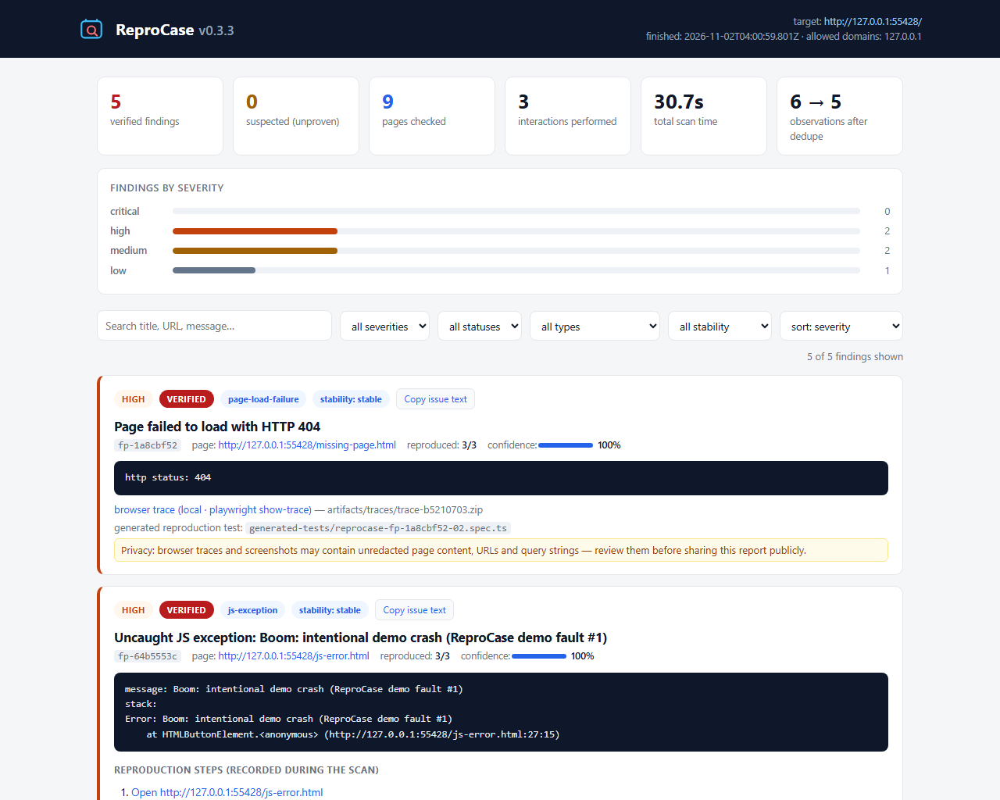
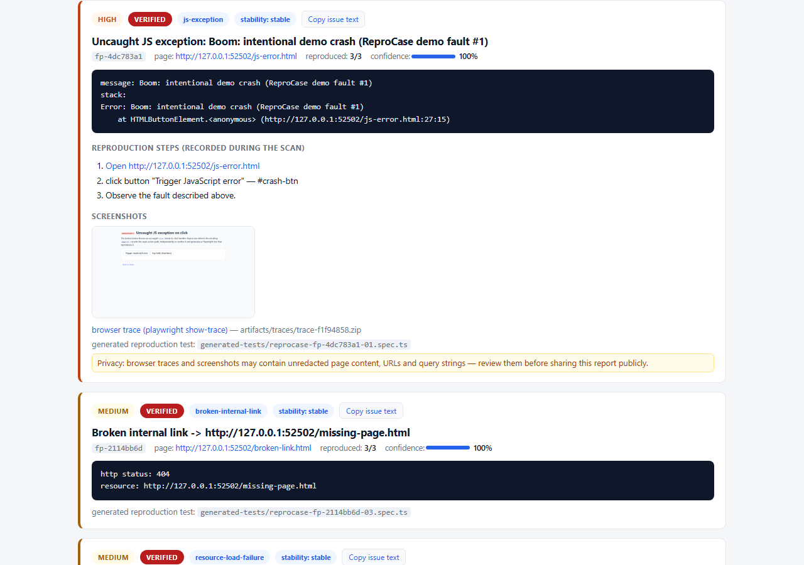
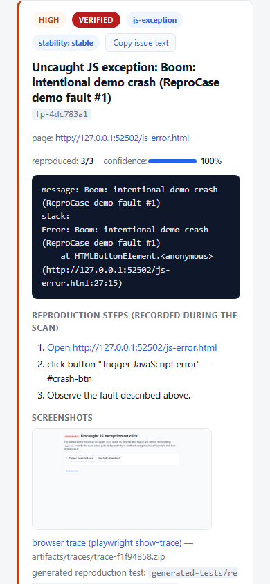

# ReproCase

[](https://github.com/geyutu6755/ReproCase/actions/workflows/ci.yml)
[](https://geyutu6755.github.io/ReproCase/)
[](LICENSE)

**网站自动故障检测与复现工具。** ReproCase 在真实浏览器中扫描网站，发现具有客观证据的故障，
对每个故障进行独立重复验证，并生成可重复执行的 Playwright 回归测试，以及同时面向人类和
AI 编程助手的报告。

English documentation: [README.md](README.md)

## 检测什么

| 故障类型 | 采集的证据 | 默认严重程度 |
| --- | --- | --- |
| 未捕获 JS 异常（含未处理的 Promise 拒绝） | 消息、堆栈、精确点击路径、截图、浏览器 Trace | high |
| 页面加载失败（HTTP ≥ 400 或导航错误） | 状态码 / 错误文本、截图 | high |
| 第一方资源加载失败（脚本、图片、CSS 等） | 资源 URL、状态码 / 网络错误、截图 | medium |
| 无效内部链接 | 目标 URL、状态码、所有引用页面 | medium |
| 横向溢出（桌面 + 移动视口） | scrollWidth 与 clientWidth 对比、越界元素、截图 | low |
| Console 错误 | 消息、页面、可复现性 | suspected（提示性质） |

每个发现都会被标注为 **verified**（在独立浏览器运行中复现成功）或 **suspected**
（观察到一次但未证明可复现）。ReproCase 不伪造结果、不判定业务逻辑正确性，
并始终列出它**没有**检查的内容。





## 快速开始

```bash
# 30 秒体验 —— 扫描内置演示网站（含 4 个植入故障）：
git clone https://github.com/geyutu6755/ReproCase.git
cd ReproCase && npm install && npx playwright install chromium && npm run build
npx reprocase demo            # 输出 reprocase-demo-report/report.html 并自动打开
```

在真实项目中使用：

```bash
npx reprocase init            # 生成起始配置（已存在则拒绝覆盖）
npx reprocase doctor          # 环境诊断：Node、Chromium、配置、目标可达性
npx reprocase scan            # 按配置扫描并输出完整报告
npx reprocase scan --url http://localhost:3000/ --out my-report
npx reprocase compare before/result.json after/result.json   # 新增/已解决/持续存在
```

> 退出码：`0` 无达到阈值的发现 · `1` 存在发现 · `2` 扫描失败（配置错误、入口不可达）。
> 适合 CI 集成 —— 详见 [docs/cli.md](docs/cli.md)。

[**在线演示报告**](https://geyutu6755.github.io/ReproCase/) —— 由 CI 流水线在每次推送到
`main` 时针对内置演示网站自动生成。

## 一次扫描产出什么

```
my-report/
├── report.html            自包含可离线打开的 HTML 报告（另有 index.html）
├── result.json            机器可读的扫描结果
├── issues.md              覆盖全部发现的 GitHub Issue Markdown
├── issues/<id>.md         每个发现一个可直接粘贴的 Issue
├── generated-tests/       可直接运行的 Playwright 复现测试 + 配置 + 说明
└── artifacts/
    ├── screenshots/       证据截图
    └── traces/            Playwright Trace（用 playwright show-trace 打开）
```

生成的 Playwright 测试**断言故障仍然存在**：Bug 存在时测试通过（证明可稳定复现），
修复后测试失败 —— 失败本身提示你换入文件中注释掉的“修复后”断言，把文件变成
永久的回归守卫。

## 跨扫描比较

`reprocase compare` 使用**稳定指纹**（类型 + URL 路径 + 错误签名）匹配发现：随机 ID、
时间戳与易变查询参数不会造成虚假差异。只有当当前扫描确实覆盖了该页面时才标记
**已解决** —— 覆盖率缩水时标记为*未确认*，绝不宣称已修复。输出 `compare.json`
与自包含的 `compare.html`。

## 常见问题与排查

- **"Refusing to scan non-local host"** —— 仅允许扫描 localhost；扫描其他主机需写入
  `allowedDomains`（这是授权门槛，不是缺陷）。
- **浏览器缺失 / 安装失败** —— 运行 `npx reprocase doctor`，会打印确切路径与修复命令。
- **没有探索到按钮** —— 查看报告中的 *Exploration log*：命中危险词（pay、delete、run
  等）的按钮会被只读策略跳过；可用 `exploration.allowSelectors` 精确授权测试控件。
- **已修复的故障显示"unconfirmed resolved"** —— 比较扫描未覆盖该页面；用与基线相同的
  范围重扫后再比较。
- **SPA 路由出现重复发现** —— 深链接会重新渲染应用；同一 JS 故障以其自身 URL 指纹
  报告属预期行为。
- **Node 版本** —— 推荐 22 或 24（当前 LTS 主线，CI 已覆盖两者）；Node 18 与 20 已停止维护（分别于 2025-04、2026-03 EOL），不再支持。

## 默认安全与隐私

- 仅允许 `localhost` 目标，除非主机被显式列入 `allowedDomains`。
- 只读优先探索：不填表单、不提交、始终关闭对话框、绝不点击危险按钮（支付 / 删除 / 提交 / 发送等）。
- 硬性预算：最大页面数、最大深度、每页最大交互数、运行超时、请求间隔。不会无限爬取。
- 报告中的 URL 会脱敏（token / password / email / session 等查询参数被遮蔽）。
- Trace 仅对 localhost 目标自动采集。**Trace 与截图可能包含未经脱敏的页面内容、URL 和查询参数 —— 公开分享本报告前请先人工审查。**

完整设计见 [docs/architecture.md](docs/architecture.md)。

## 文档

- [安装指南](docs/installation.md)
- [CLI 使用说明](docs/cli.md)
- [配置说明](docs/configuration.md)（[示例配置](reprocase.config.example.json)）
- [架构说明](docs/architecture.md)
- [贡献指南](CONTRIBUTING.md) · [变更日志](CHANGELOG.md) · [许可证（MIT）](LICENSE)

## 本地开发

```bash
npm install
npx playwright install chromium
npm run build      # tsc -> dist/
npm test           # 单元测试
npm run test:all   # 单元 + 集成（真实浏览器）+ CLI 端到端
```

测试套件会扫描内置演示网站，断言四种植入故障全部被检出、干净对照页零误报，
并且生成的测试能通过真实 Playwright 运行器复现每个故障。

## 状态

v0.3.3 —— 报告附件安全后续修复与 CI 运行时维护：Trace/截图附件路径改为"仅本地相对路径"校验（不可信 `result.json` 无法再把它们变成 `javascript:`/`data:` 链接或路径穿越来源），正常本地附件仍可打开；CI Action 升级到 Node-24 运行时主版本（GitHub 运行器已移除 Node 20）。基于 v0.3.2（报告链接协议校验、Trace 诚实标注）、v0.3.1（故障聚类诚实表述、聚类需跨≥2页、`issues.md` 表头准确）与 v0.3.0 特性线——跨页面故障聚类、自适应异步观测（可配置/有预算）、开放 Shadow DOM 与同源 iframe 检测、scan --compare-with。详见
[变更日志](CHANGELOG.md)、[测试基线](docs/test-baselines.md) 与[兼容性矩阵](docs/compatibility.md)。

## 许可证

[MIT](LICENSE) © ReproCase contributors
